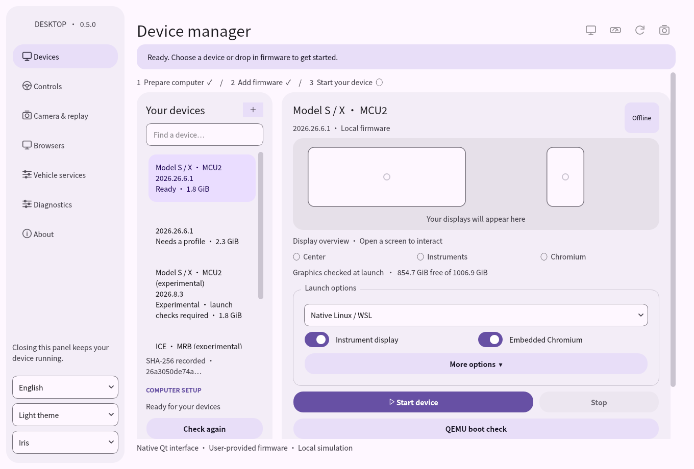
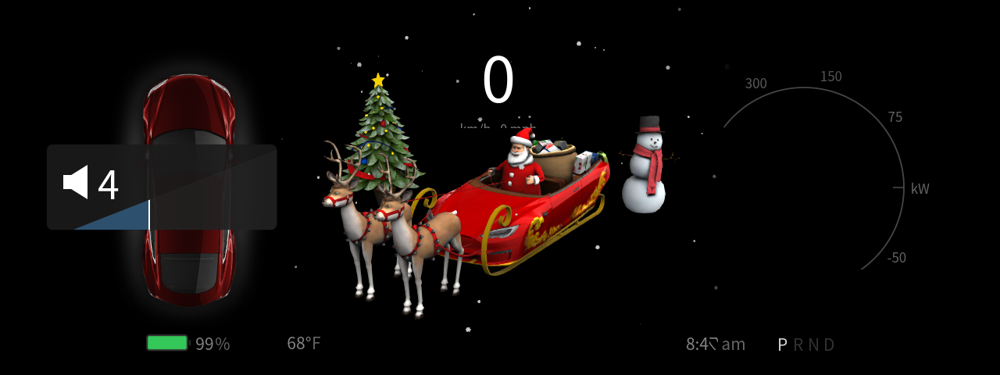
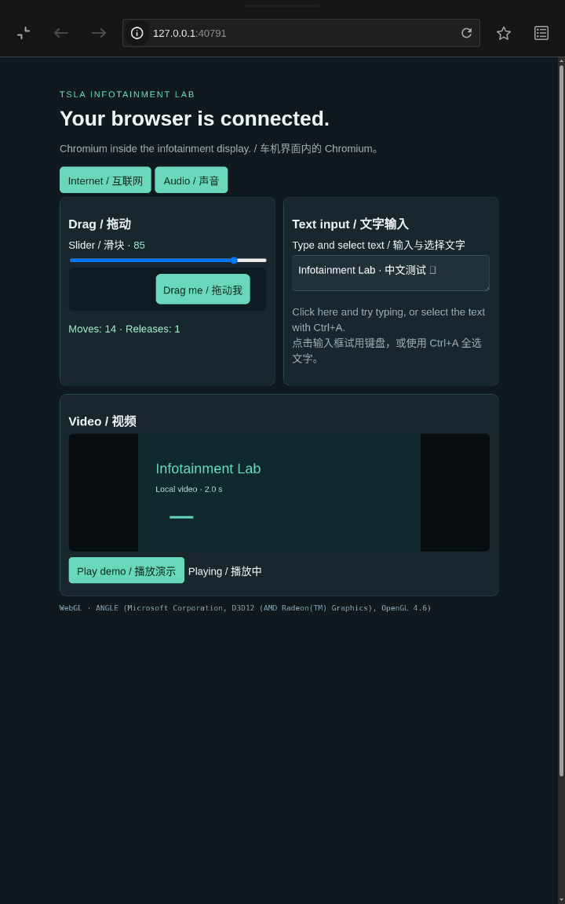
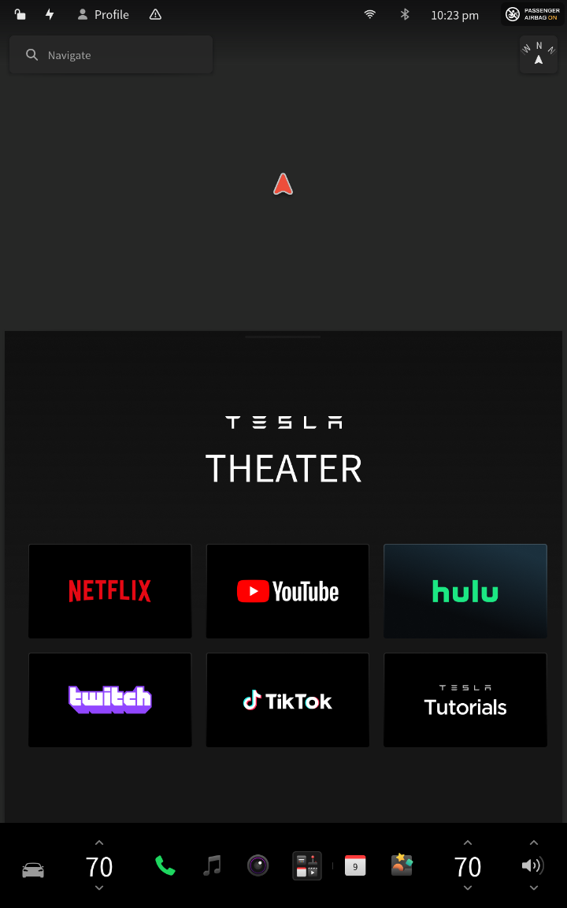
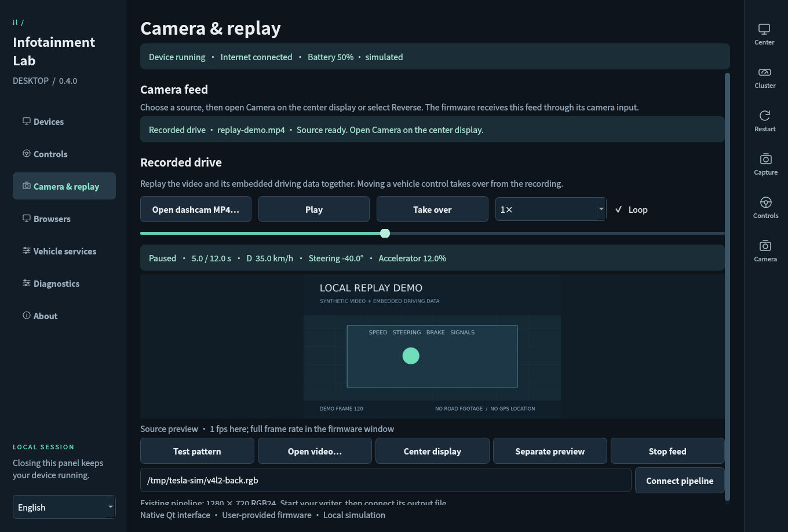

# Infotainment Lab

[Source](https://github.com/derrickyau9/tsla-infotainment-lab/releases/latest) · [Changelog](CHANGELOG.md)

Run infotainment software on your own computer, with the center display and instrument cluster in separate desktop windows. A native Qt app handles your firmware library, driving controls, browser windows, cameras, and recorded drives.

Infotainment Lab runs on Linux and Windows with Debian WSL2. The Material 3 control panel supports native and QEMU desktop sessions. The current panel version is **0.5.5**; the [changelog](CHANGELOG.md) records the Console, Vehicle config, Alerts, Service Mode, Model 3 display and navigation improvements.



## Bring your own firmware

**You need your own compatible Firmware Dump.** Firmware and maps are not included in this repository or its downloads. Obtain a dump you have permission to use; this project does not provide extraction tools or export tutorials.

The app reads fonts and vehicle assets from your selected image. Model S/X MCU2 images use a center display and instrument cluster; ICE images use a landscape center display. The built-in MCU2 profile is for **2026.26.6.1**. Other Model S/X MCU2 and ICE builds launch on an **experimental** generic profile for their platform, marked as such in Devices; they have no validation record (see [compatibility](docs/compatibility.md)).

## Get started

You need an x86_64 computer and a Linux graphical desktop. On Windows, install **Debian under WSL2** with [WSLg support](https://learn.microsoft.com/en-us/windows/wsl/tutorials/gui-apps).

1. Download and fully extract a release archive. Keep the `_internal` folder beside the executable.
2. For the Linux app, run `bash Launch-Linux.sh`, or double-click **Launch-WSL.cmd** on Windows. The Windows control-panel package starts with **InfotainmentLab.exe**.
3. Select **Prepare computer** to install the Linux runtime components.
4. Drop your firmware image into **Devices**, select it, then choose **Start device**.
5. Use **Center** and **Cluster** in the toolbar to bring a display forward. **Capture** saves both screens as PNGs.

Run the app as your normal desktop user. Setup asks for administrator access when it needs to install packages. Linux binary downloads require glibc 2.41 or newer.

Closing the control panel leaves the session running. **Stop** ends it; **Restart** starts again in Park. Device settings and your selected map package are remembered.

To import maps, click the import area on Devices and select a TeslaMaps SquashFS
image (`.map`, `.ssq` or `.squashfs`). North America (`NA-…`) and Europe (`EU-…`)
releases are recognized from the first line of the image's `VERSION` file.
Select the imported release under **More options → Maps**, then start the device
to mount it read-only. Native sessions start the firmware's Valhalla engine and
TeslaMaps service using the selected routing tiles and address database.
Set latitude, longitude and heading under **Vehicle services → Navigation**
to simulate a position; these values are remembered across restarts. Street
and satellite imagery still use the network provider and need Internet access.
European offline routing was verified on the experimental Model 3 ICE session;
other builds, NA routing, address search and QEMU execution remain unverified.

**Full reset**, next to **QEMU boot check** on the Device page, stops the session and deletes the lab's cached session, engine copy, mount points, library index and saved device settings, as on a first import. Your firmware, map and QEMU guest files are never touched. Stop and Full reset unmount the image themselves, lazily if a Console shell or a leftover process still holds it, and a start after the mount helper died clears the dead mount and mounts the image again.

### From source

Install Python 3.11+ and `python3-venv`, then:

```bash
git clone https://github.com/derrickyau9/tsla-infotainment-lab.git
cd tesla-cid-lab
bash Launch-Linux.sh
```

The launcher creates a Python environment and installs Qt on first use. On Windows, use **Launch-WSL.cmd** from the checkout. To select another distribution, run `Launch-WSL.ps1 -Distribution <name>` in PowerShell.

For a Start-menu shortcut, run `scripts/install-wsl-shortcut.ps1`. If the window does not open, launch from a terminal and check `~/.local/state/tsla-infotainment-lab/launcher.log`.

#### Display scaling on Windows

Under WSLg the lab reads your Windows display scale and draws everything at that size: the panel through Qt, and the center and instrument displays by starting the firmware at a larger window scale on a matching larger screen. Nothing is stretched, so text stays sharp and touches stay aligned. The displays shrink as needed to fit your desktop, in steps that keep whole pixels. A new scale applies from the next session start. Set `INFOTAINMENT_LAB_SCALE` (for example `1.25`, or `1` to turn scaling off) to choose another size. `python3 -m infotainment_lab.display_scale` prints the detected values.

QEMU mode needs a guest image built with this version of `scripts/build-virtual-guest.py`; older images keep the default size.

WSLg's own fractional scaling (`WESTON_RDP_FRACTIONAL_HI_DPI_SCALING` in `%USERPROFILE%\.wslgconfig`) stretches every window as a bitmap, which blurs text and enlarges the cursor. The lab takes it into account, but it isn't needed. If an earlier version added it, `python3 -m infotainment_lab.display_scale --disable-wslg-scaling` removes the line; then run `wsl --shutdown`.

### QEMU mode

Choose **QEMU** in Devices to run the desktop inside a Debian guest. The panel manages startup, shutdown, dual-screen previews, browser cards, driving inputs, and camera replay. MCU2 uses VirGL for graphics, with VirtualGL sharing the GPU with the instrument window.

QEMU uses a replacement Linux kernel and your read-only firmware image. Prepare the guest disk locally using the [QEMU desktop guide](docs/virtual-desktop.md).

## Make it yours

Choose System, Light, or Dark appearance and an Iris, Blue, or Leaf accent. Smaller windows switch to compact navigation.

## Driving and instruments

Select P, R, N, or D and adjust speed, accelerator, brake, steering, and turn signals in **Controls**. Both displays receive the same local inputs. Park resets speed and accelerator to zero. Drive, Wheel buttons and the vehicle-service groups share one tab bar.

The Drive tab's power meter spans **-100 kW** (regen) to **+400 kW** (drive) in 1 kW steps and writes that value to `VAPI_powerLevel`. The kW unit is inferred from the firmware, not yet confirmed on a running display.

**Car off** is separate from Park. It shifts to Park, zeroes speed and accelerator, and turns off the power values the firmware watches: the rails, driver present, accessory power and the display keep-alive and backlight. The firmware then sees an off car and can sleep its screens. Selecting a gear turns the car back on, and the Drive feedback line shows the firmware's answer as **Power**.

The steering-wheel buttons control volume, mute, playback, and tracks. Hold Volume + or − for continuous adjustment. The right-hand buttons open instrument panels. Santa mode and supported display preferences carry across both screens, along with music titles and playback information.



**Vehicle services** brings together climate, doors, lights, energy, and audio. Open a door, change the battery level, or switch the headlights; the panel shows the firmware's response. Changes made through the native climate and audio controls feed back into the panel. See the [vehicle services guide](docs/vehicle-services.md).

These controls operate the local desktop session. They do not connect to a physical vehicle.

## Service Mode

Enter Service Mode on the center display with the normal access code (Controls → Software, hold MODEL), or use the Developer, Service and Factory switches on the **Modes** tab. The lab starts the firmware's own Service panel: its `service-ui` backend in a private network namespace and its `chromium-odin` window, with the firmware's data-value server supplying vehicle values. A stand-in for the diagnostic engine lists the image's own task catalogue (691 tasks on a 2026.8.3 MCU2 image).

This is **experimental**. Tasks never run: each ends with an error saying no vehicle is attached; with the CAN service running, each is first offered to the lab gateway, which passes diagnostic requests only while unlocked and in Service Mode. Gateway-config values are placeholders, the VIN stays empty, the CAN Viewer stays locked, and Service Mode Plus is not available. No token, identity or access-code check is changed. See [Service Mode](docs/vehicle-services.md#service-mode).

## Vehicle configuration

**Vehicle config** imports a `Name,Value` CSV, such as a dump from your own car. Search it, show changed values only, edit or add keys, and **Apply** to write them to the running displays; each row shows the firmware's answer. **Defaults** returns to the lab's vehicle profile and **Export CSV** saves your edits.

Defaults automatically follow the selected firmware: Model 3 for single-display ICE/MRB images, Model X for S/X images. The two layouts keep separate saved edits. Use a Model 3/ICE firmware image to run the Model 3 interface; the generic profile remains experimental.

Imports keep personal data out: logins, passwords, PINs, keys, device and network identifiers, and locations are never imported, stored or written. Live readings such as display power are listed but never written. Configurations for the other layout are refused.

Some car-config values make the firmware restart its UI. The lab handles that as a configuration restart, drops conflicting language settings after three restarts, and records each restart. See the [vehicle configuration guide](docs/vehicle-config.md).

## Alerts

Refused or unknown configuration keys and firmware restarts are listed under **Diagnostics › Alerts**, with a count on the Diagnostics sidebar entry, instead of popups. Each restart alert names the display and the values it restarted for.

## Logs

**Diagnostics › Logs** lists every log the session writes and shows the one you choose, refreshed once a second while the tab is open. QtCar's own output (the lines the bench prints in its terminal) is in the center and cluster logs. **All logs** in the list streams every log together, each line tagged with its file name. It stops reading when you leave it.

**Diagnostics › Environment** holds Check environment and its results.

**Diagnostics › Firmware files** lets you select an imported firmware, enter an existing file path inside its SquashFS and choose a local replacement. Stop that session before changing files; replacements apply at the next launch and persist per image. **Restore selected original** removes a replacement. The original SquashFS stays unchanged and the combined runtime mount remains read-only. Native mode needs `fuse-overlayfs` through **Prepare computer**; QEMU needs a rebuilt guest.

**Debug**, below Diagnostics, displays current process logs and OS debug sources, with automatic refresh, source selection and a line filter. Native mode identifies the host kernel and session journal; QEMU shows guest serial output and available guest journals. See the [firmware replacements and Debug guide](docs/firmware-debug.md).

## Console

**Console**, the third tab of **Diagnostics** (its terminal-icon **Connect** button), opens a terminal inside the running CID's read-only firmware root, with Tab completion, history and Ctrl+C. The native engine enters it directly through a user namespace. The QEMU engine connects over SSH to `127.0.0.1:2222` with a key the lab creates and authorizes on first **Connect**, then enters the image the guest mounts at `/firmware`. Guest images built before the SSH server was added need a rebuild.

## Firmware network isolation

Firmware processes and browsers the lab starts cannot reach Tesla's servers. Names under `tesla.com`, `teslamotors.com`, `tesla.services` and `tesla.cn` do not resolve, and each process log records `netguard: blocked lookup of …`. The two local media names still map to loopback, and other traffic such as map tiles is unchanged. Connections to literal IP addresses are not intercepted.

## Browser workspace

Open **Browsers**, enter an address, and choose **Browser** or **Card view**. **Theater** opens the firmware's app catalog. Browser and Card share a profile, with keyboard input, scrolling, text selection, and dragging inside the embedded view.

Leave the address empty to open **Browser test page**: local HTTP checks,
viewport details, keyboard-event count, dragging, audio, generated video, scrolling
and WebGL. The editable source is `infotainment_lab/runtime/welcome.html`, served
by `runtime/browser-page.py` on a loopback port chosen at each session start.
The running copy is under `~/.local/share/tsla-infotainment-lab/engine/runtime/`;
edit the project source for changes that survive the next runtime staging.
Music apps open from the center display and use their own account sign-in.

 

## Cameras and recorded drives

In **Camera & replay**, choose a test pattern, open a video, or connect an existing RGB pipeline. Open the camera on the center display, or select R for the backup-camera view.

Choose **Open dashcam MP4…** to play a recording with embedded driving data. Gear, speed, pedals, steering, and indicators follow the video. Pause, seek, playback speed, and looping apply to both. **Take over** returns control to you; Play resumes the recording.



To try a sample recording, run `python3 scripts/make-replay-demo.py` and open `build/replay-demo.mp4`.

An existing camera pipeline can publish **1280 × 720 RGB24** frames through an atomically replaced file, such as `/tmp/tesla-sim/v4l2-back.rgb`. Enter that path in the panel. See [camera and replay formats](docs/replay.md) for the details.

## CAN and gateway observation

Open **CAN & gateway** to observe the running Model 3 OS's gateway traffic. The
panel shows raw records and decoded signals using a selected local DBC, with
display pause, ID/message filtering and CSV copying. Firmware metadata supplies
the current message names, units and enums. Network sends and gateway API
requests are separate observation points.

Bus filters are **Party**, **Chassis**, **Body / VH**, and **Gateway / Ethernet**.
The tested firmware sends Ethernet records toward the local gateway; their
identifiers do not establish a physical CAN bus, so empty CAN filters stay empty.
This view is bounded and best effort, and a successful UDP send does not prove
delivery on a vehicle CAN bus.

**FRAME INJECTION** creates continuous echo rules from a selected decoded
network frame. Check the signal values to override, save the rule, then enable
it. Each new matching OS send produces one edited Ethernet record to the same
local Gateway (`127.0.0.102:4321`). Unselected bits follow the new source frame;
no periodic or CSV replay is used. Rules show enabled state, echo/skip counts
and the last output, with individual disable/delete and **Stop all echoes**.
They are disabled on every device restart. Invalid values and ambiguous DBC
fields are refused; counters and checksums are not recalculated automatically.
This sends to the local gateway endpoint; it does not establish receipt by the
OS or transmission on Party, Chassis or Body.

The independent LAB gateway simulator remains available through the CLI.
See the [CAN and gateway guide](docs/can-gateway.md) for both paths.

## Development

This is an independent compatibility and cybersecurity engineering project. It brings together native graphics, input routing, process management, and local simulation while keeping the supplied firmware unchanged.

See the [architecture](docs/ARCHITECTURE.md), [compatibility notes](docs/compatibility.md), and [contribution guide](CONTRIBUTING.md).

```bash
python3 -m venv .venv
source .venv/bin/activate
python -m pip install -e '.[dev]'
python -m pytest -q
python scripts/build.py
```

On Windows, activate with `.venv\Scripts\Activate.ps1`. Build on the target operating system; output goes to `dist/`.

Firmware, maps, recordings, browser profiles, logs, and credentials stay out of the repository. Public replay screenshots use generated footage.

Not affiliated with or endorsed by Tesla. Project code is MIT-licensed; firmware, trademarks, screenshots of third-party interfaces, and dependencies retain their respective rights. See [third-party notices](THIRD_PARTY_NOTICES.md).
